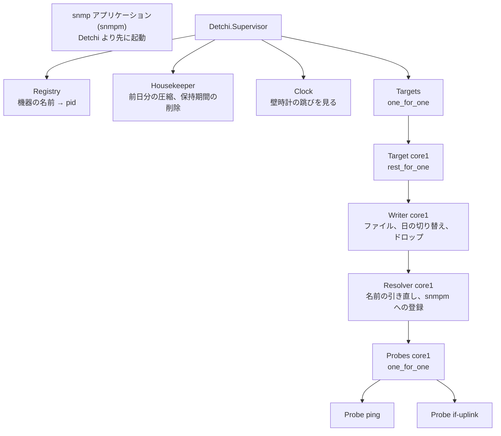
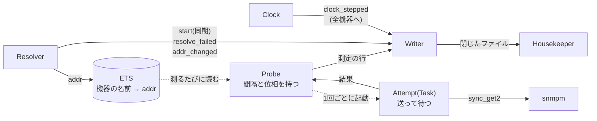

# Detchi 基本設計書

## 1. 目的

ネットワークのメトリックスを**収集して記録するだけ**のサービス。Linux の上で常に動き続け、ネットワーク機器の RTT と SNMP の値を測って、そのまま記録に残す。

Koitohan(Raspberry Pi で動く、ネットワーク機器向けの小さな管理サーバ)に組み込むことを想定して作るが、Koitohan には依存しない汎用のものにする(9 節)。

### 1.1 名称

「でっち(丁稚)」。Koitohan は大阪の商家の末娘(「小いとはん」)から取った名前で、同じ商家の住人として「Koitohan と Detchi」と並べる。

丁稚奉公は厳しいものだったが、商人としての修行の場でもあり、手代、番頭、暖簾分けというキャリアパスもあった。厳しい面だけを見るのではなく、そちらの意味を込めている。いまは RTT と SNMP を書き留めるだけの丁稚だが、gNMI や NETCONF を覚えて育っていく余地がある。

綴りはヘボン式の `Detchi`。英語の `tch` はいつも /tʃ/ と読まれるので、英語話者にも「デッチ」と読める。訓令式の `Decchi` は一度選んだが、英語では `cc` が /ks/ や「デッキ」と読まれうるので改めた。README には「でっち(丁稚)」と添える。Hex.pm に同名のパッケージはない(2026-10-22 時点)。

名前の候補として、ほかに Daifukucho(大福帳。お金の印象が強いので見送り)、Tomegaki(留書)、Goyokiki(御用聞き。機器から送ってくる方式を足すと合わなくなる)、NexRecorder などを検討した。

### 1.2 NexPinger との関係

[NexPinger](https://github.com/jolly-jive/nexpinger)(同じ作者の Elixir 製 CUI。ICMP / TCP / UDP で多数のホストを監視する)を参考にする。ただし用途が違う。

- NexPinger:一時的なトラブルシューティングのための道具。宛先はその場で決まる。
- Detchi:常に測り続けて記録を残すもの。

NexPinger とは**コードを共有しない**(ライブラリ化も、Hex.pm への登録もしない)。

- NexPinger は Windows に対応する必要があるが、Detchi は Linux だけでよい。
- 必要な部分は写して、Linux だけを前提に素直に書く。

## 2. 範囲

- 測るもの
  - ICMP / TCP / UDP の RTT
  - SNMP の値
  - gNMI と NETCONF は今後の検討項目。
- 機能は**収集、記録、圧縮、データのダウンロード**だけ。
- 警告、整形、統計処理、可視化、チャートはサポートしない。必要なら、データをダウンロードして、Detchi とは別の仕組みで行ってもらう。
  - ここでの警告は、測ったデータに閾値を当てて知らせること。Detchi 自身が動いているかの判定(9.5 節)は含まない。

## 3. 実装

- Elixir/OTP で書く。対象は Linux だけ。
- 要求する OTP は **28 以上**(zstd のため。6.3 節)。
- SNMP は OTP 標準の `snmp` アプリケーション(マネージャーの `snmpm`)を使う。v1、v2c、v3 に対応しており、外部の依存が要らない。v2c の get で動くことを確かめた(2026-10-24。5 節)。
- 形は **escript**(NexPinger と同じ)。1つのファイル `detchi` に、サブコマンドを持たせる。
  - `detchi run`:サービスとして動き続ける。
  - `detchi check-config`:設定を確かめる(7.9 節)。
  - `detchi status`:記録を見て稼働を確かめる(9.5 節)。
  - Mix のリリースは採らなかった。リリースの利点は ERTS を同梱できることだが、Detchi はリリースのほかの機能をほとんど使わず、むしろ切る手間が増える。
    - リリースの `start` は既定で Erlang の分散を有効にし、epmd を起動して待ち受ける(9.5 節で、待ち受ける口を増やさないと決めた)。
    - `remote`、`rpc` などの使わないコマンドが付く。
    - リリースの名前を `detchi` にすると、`bin/detchi` は Mix のスクリプトになるので、`detchi check-config` の形にするには包むスクリプトが要る。
    - 1回だけ動くコマンドは `bin/<リリース> eval` で動くこと(引数、終了コード)も確かめたが、上の理由で escript にした。
  - escript の注意(2026-10-24 に確かめた)
    - `mix.exs` の `escript:` に **`app: nil`** を書く。書かないと、escript は `main/1` の前に自分のアプリケーションを起動するので、`check-config` や `status` でも監督ツリーが動き、測定が始まってしまう。アプリケーションは `run` の中で自分で起動する(`snmpm` の設定を書き出したあと。5 節)。監督ツリーを起動しないことはテストで確かめる。
    - SIGTERM は OTP の既定の処理で `init:stop` になり、監督ツリーの子の `terminate/2` が呼ばれる(`stop` の行はここで書く。7.9 節)。終了コードは 0。
    - 捕まえていない例外は終了コード 1、`System.halt/1` の値はそのまま終了コードになる。Erlang の分散と epmd は動かない。
    - 起動の時間は、開発の PC で 0.44 秒(Raspberry Pi は未計測)。
    - 実行には Erlang/OTP 28 以上が要る(escript は ERTS を含まない)。先頭の行は `#! /usr/bin/env escript` なので、`escript` が `PATH` にあること。
    - escript は `priv` を扱えないが、Detchi は `priv` を使わない。`config/runtime.exs` も使えないが、設定は YAML と環境変数なので要らない。

### 3.1 プロセスの構成(案)

`detchi run` で動くプロセス(アクター)の構成。実装しながら見直す。残っている点は 10 節。

監督ツリー:



メッセージの流れ:



- `snmp` アプリケーションは、`snmpm` の設定を書き出してから、Detchi のアプリケーションより先に起動する(3 節、5 節)。Detchi の監督ツリーの外にある。
  - タイムアウトの後に届いた応答を捨てる user のモジュール(`handle_pdu/4`。5 節)は、Detchi のプロセスではなく、`snmpm` のプロセスの中で呼ばれる。
- **機器ごとに Writer を1つ置く。** 機器のファイルに書くのは Writer だけ。
  - 出来事の行を機器ごとのファイルに書き、背圧によるドロップも機器ごとの書き込みで起きる(6.1 節)ので、それに合わせた。
  - 日の切り替え、前日のファイルを開いておくこと、`file_opened` の行(6.2 節)も Writer が受け持つ。前日のファイルを閉じたら Housekeeper に知らせる。
  - Writer が自分で書く行は `start`、`file_opened`、`stop`、`dropped`。`resolve_failed` と `addr_changed` は Resolver から、`clock_stepped` は Clock から受け、Writer が受け取った時刻を `ts` にする。`file_opened` に書くアドレスのために、Writer は `start` と `addr_changed` で使っているアドレスを覚えておく。
  - 書けなかった行(ディスクが一杯、権限がない、など)は落として数える。次に書けたとき、その行の前に `dropped` の行を書く。ファイルを開くのは書くたびに試し直す。落とし始めたときと、書けるようになったときに、標準出力のログに1行ずつ出す。
  - 打ち切った要求の数(`stop` の `abandoned`)は、Probe が止まるときに同期の call で Writer に足す。cast にしないのは、Writer が止まる前に確実に届くように。`start` を書くと 0 に戻す。
  - **Writer が落ちて起動し直したときは、もう一度 `start` を書く。** `rest_for_one` で Resolver も起動し直し、最初の名前解決の結果を `start` として渡すので、何もしなくてもそうなる。前の Writer の `stop` はないので、クラッシュや電源断と同じく、その前の空白は止まっていたと読める。Resolver だけが落ちたときも `start` が増えるが、測定が始まり直したことを表すので、それでよい。
- **機器の中は `rest_for_one` で、Writer、Resolver、Probes の順に並べる。**
  - Resolver と Probe は Writer に書かせるので、Writer が先に要る。Probe は Resolver のアドレスを使う。
  - 止まるときは逆の順になるので、Probe が先に止まり、結果を待たずに打ち切った要求の数を Writer に渡す。最後に Writer が `stop` の行(`abandoned`)を書いてファイルを閉じる(7.9 節)。
  - Probe は、互いに巻き込まないように、1段下の `one_for_one` の監督の下に置く。
- **Resolver も機器ごとに1つ置く。** `host` が IP アドレスでも置き、アドレスを持つだけにする(機器による違いを Probe に見せない)。
  - アドレスが変わったら、`snmpm` に機器を登録し直す(`snmpm:register_agent/3` はアドレスで登録するため。5 節)。
    - 登録してから表に入れる。SNMP の Probe が、まだ登録していないアドレスで `sync_get2` しないように。
    - 登録は SNMP を実装するときに足す。それまでは、Resolver に登録の関数を渡す口だけを置き、何もしない。アドレスを `snmpm:update_agent_info/4` で差し替えられるか、`unregister_agent` してから登録し直すかは、そのときに確かめる。
- **Probe はアドレスを ETS から読む。** システム全体で1つの表に、機器の名前ごとに、使うアドレスか、一度も引けていないこと(`{:unresolved, errno}`)を入れる。
  - 書くのは Resolver だけで、Probe は測るたびに読む。Probe は Resolver に call しないので、Resolver が名前解決で待っている間も Probe は止まらない。Resolver が Probe の pid を知る必要もない。
  - 引き直しに失敗しても、表のアドレスは書き換えない(前のアドレスで測り続ける。7.6 節)。`{:unresolved, errno}` になるのは、起動してから一度も引けていないときだけ。引けなかった理由は `resolve_failed` の行に書く。
  - 一度も引けていない間は、再試行で失敗するたびに `{:unresolved, errno}` を新しい errno で書き直す(`nxdomain` が `timeout` に変わった、など)。Probe の行の `errno` が、いちばん新しい理由になるように。
  - 表は、落ちないプロセスが持つ(`Application.start/2` で作る)。Resolver が起動し直しても消えない。
- **`start` の行は、どの測定の行よりも先に来るようにする。**
  - Resolver は、最初の名前解決を `init` ではなく `handle_continue` で行う。引けない機器が、ほかの機器の起動を待たせないように。
  - 最初の結果が出たら(引けなくても)、Resolver は Writer に同期の call で `start`(その時点のアドレス。引けていなければなし)を渡し、Writer が `start` の行を書いて返してから、表に入れる。
  - Probe は、表に機器がまだなければ、その回は測らず、行も書かない。
  - こうすると、`start` の行が先に来ることが、メッセージの届く順に頼らずに決まる。起動のときに測らないのは、最初の名前解決が終わるまでだけ。
  - 引き直しの結果(`resolve_failed`、`addr_changed`)は cast でよい。測定の行と前後してもかまわない。
- **Probe(測定ごとに1つ)と Attempt(1回の要求ごとに1つ)を分ける。**
  - Probe は、間隔と測る時刻の分散(7.5 節)を受け持ち、待たない。送って待つのは Attempt(`Task`)で、`recv` や `sync_get2` で待っている間も、Probe の時刻の管理が止まらない。
  - `timeout` は `interval` より短い(7.3 節)ので、待っている Attempt は Probe ごとに多くて1つ。打ち切った数は、Attempt が残っている Probe の数になる。
- **Housekeeper はシステム全体で1つ。** Raspberry Pi で圧縮が一度に重ならないように。
  - 起動のときの片付け(過ぎた日の `.jsonl` の圧縮、`.part` の削除。6.2 節)と、保持期間を過ぎたものの削除(6.4 節)も受け持つ。
- **Clock もシステム全体で1つ。** 壁時計が跳んだら、Registry で全機器の Writer を引き、`clock_stepped` の行(6.1 節)を書かせる。

## 4. 測り方(RTT)

- ICMP は、権限の要らない ICMP のソケット(datagram socket)を使う。Docker の既定の `net.ipv4.ping_group_range` で動く。
- ICMP と UDP のソケットには、いつも `IP_RECVERR`(IPv6 は `IPV6_RECVERR`)を付ける。
  - 付けないと、Linux は ICMP の誤りのうち「致命的」とするもの(Port Unreachable など)しかソケットに伝えない。Time Exceeded や、ルーターがよく返す Host Unreachable、Net Unreachable は伝わらず、`timeout` として記録されてしまう(2026-10-24 に、ICMP、ICMPv6、UDP のソケットで確かめた)。
  - 付ければ、受信がすぐに errno(`ehostunreach` など)を返し、誤りのキュー(`MSG_ERRQUEUE`)から ICMP の type と code、返してきたアドレスが取れる。記録の形は 6.1 節の `reason` が `icmp` のもの。
  - 誤りのキューの読み方:OTP の `socket:recvmsg/5` に `[errqueue]` を渡すと、制御メッセージ(`ctrl`)に `recverr` が入る。type と code は、OTP が名前に直したもの(`time_exceeded` など。知らない値は数値のまま)ではなく、生のバイト列(`struct sock_extended_err`)から数値で読む。
  - 手元で ARP が引けないときは、約 3 秒後にカーネルが自分で Host Unreachable を作る。そのとき、返してきたアドレスは自分のアドレスになる。
- UDP は NexPinger に準じる(4.1 節)。

### 4.1 UDP

**NexPinger v1.4.0 の動作に合わせた。** コードは共有しないので、定義をここに書く(NexPinger の `lib/nexpinger/udp_probe.ex`。2026-10-24 時点の main でも、UDP の測り方は v1.4.0 から変わっていない)。

- **確実に応答が期待できる要求だけ**を送る。設定の `service` で選び、ポートの既定はサービスの標準のポート(7.2 節)。

  | `service` | ポートの既定 | 送る要求 |
  | --- | --- | --- |
  | `dns` | 53 | `. SOA` の問い合わせ。RD=0、EDNS なし。17 バイト。 |
  | `ntp` | 123 | NTPv4 のクライアントの要求(mode 3)。48 バイト。 |
  | `quic` | 443 | 予約された版(`0x1a2a3a4a`)の long header の Initial。1200 バイトまで埋める。 |

- 要求の中身(バイト列)
  - `dns`:ヘッダーは、ID(乱数 16 ビット)、フラグはすべて 0(QR=0、OPCODE=0、RD=0)、QDCOUNT=1、ほかの数は 0。質問は、ルートの名前(`0x00`)、QTYPE=6(SOA)、QCLASS=1(IN)。
    - SOA は応答が小さい(`. NS` はルートサーバー 13 個とグルーで 512 バイトを埋める)。TXT も小さいが、トンネリングの検知に引っかかりやすい。
    - RD=0 なので、リゾルバーは再帰せず、キャッシュから答えるか断る。RTT にリゾルバーの再帰の時間が入らない。
    - EDNS を付けないので、応答は 512 バイトに収まり、断片化しない。
  - `ntp`:先頭のバイトが `0x23`(LI=0、VN=4、Mode=3)、続く 39 バイトが 0、最後の 8 バイト(Transmit Timestamp)が乱数。Transmit Timestamp が 0 の要求を捨てるサーバーがあるため。
  - `quic`:先頭のバイトが `0xC0`(long header、Initial)、版が `0x1a2a3a4a`、DCID の長さ 8 と乱数 8 バイト、SCID の長さ 8 と乱数 8 バイト、残りは 0 で埋めて全体を 1200 バイトにする。
    - 版は RFC 9000 の 15 節で予約された形(`0x?a?a?a?a`)なので、サーバーは対応しておらず、Version Negotiation を返す。暗号の処理は要らない。
    - 1200 バイトより小さい Initial は、サーバーが捨てる(RFC 9000 の 14.1 節)。
- 送り方
  - 測るたびに新しいソケットを開き、宛先(`addr` と `port`)に connect してから送る。OS がほかの送り元からの datagram を捨てる。また、前の回への遅れた応答が、次の回の応答と取り違えられることがない。
  - ソケットには `IP_RECVERR` / `IPV6_RECVERR` を付ける(4 節)。**ここは NexPinger v1.4.0 と違う。** NexPinger は付けていないので、ルーターが Host Unreachable や Time Exceeded を返しても `timeout` になる。
  - 再送しない(SNMP と同じ。7.4 節)。
- 成功の条件
  - **宛先から UDP の応答が何か1つ返れば `ok`。中身は確かめない。** 目的は届くかを測ることなので、DNS の NXDOMAIN や REFUSED、NTP の Kiss-o'-Death、壊れた応答も `ok`。DNS の ID も照合しない(connect したソケットに、その回だけ開いているため)。
  - `timeout` の間に応答がなければ `timeout`。
  - ICMP の Port Unreachable は UDP の応答ではないので `ok` にしない。`status` は `refused`(TCP の RST を `refused` にするのと揃う)。`error` は `reason` が `icmp` のもの(6.1 節)。
    - Port Unreachable は、宛先でなく途中のファイアウォール(iptables の `REJECT` など)が返していることもある。`error` の `from` で、どちらが返したかが分かる。文書に書く。
  - ほかの ICMP の誤り(Host Unreachable、Time Exceeded など)は `status` が `unreachable`。`error` は同じく `reason` が `icmp` のもの。
  - `rtt_us` を付けるかは 6.1 節の規則による(ICMP がネットワークから届いたときだけ付ける)。
- RTT の起点と終点
  - 起点は要求を送る直前、終点は最初の応答(または Port Unreachable)を受け取ったとき。サーバーの処理の時間を含む。
  - 時間は単調な時計(`System.monotonic_time/1`)で測る。行の `ts` は起点と同じ時点の壁時計(6.1 節の「要求を送った時刻」)。
  - NexPinger は起点を connect の前に取っている。UDP の connect は何も送らないので、違いはシステムコール1回分で、実質は同じ。Detchi では `ts` と意味を揃えるために、送る直前にした。
  - `timeout` は、送ってから応答を待つ時間。
- NTP の間隔
  - 公開の NTP サーバーは、短い間隔の問い合わせを制限する(Kiss-o'-Death を返す、捨てる)。NexPinger は NTP の `interval` の既定を 8 秒にし、それより短いと起動のときに警告している。
  - Detchi の `interval` の既定は 60 秒で、8 秒より十分長いので、NTP に特別な既定は設けない。
  - `service` が `ntp` で `interval` が 8 秒より短い測定には、**警告**を出す。
    - 出す場所は `detchi check-config` の出力と、起動のときの標準出力のログ。警告では止まらない(`check-config` の終了コードも 0)。
    - 宛先のアドレスによって警告を省くこと(プライベートアドレスなら自分で運用しているとみなす、など)はしない。`host` がホスト名なら、設定を読んだだけではアドレスが分からず、引き直しで変わることもある。また、プライベートアドレスでも自分で運用しているとは限らない(社内の NTP サーバー、プロバイダーの機器など)。警告は起動のときに1行出るだけなので、自分のサーバーなら読み流してもらえばよい。
    - 自分で運用していないサーバーに 8 秒より短い間隔で問い合わせないよう、文書にも書く。

## 5. SNMP

- 値は**生の数値の OID**で記録する。MIB の名前は使わない(MIB ファイルの管理を抱えないため)。
- カウンターは生の値で残す。差分や bps への換算は、使う側に任せる。
- `sysUpTime.0` は Detchi が自動では足さない。サンプルの設定と文書で、任意の項目として勧める。
  - 役割は、機器の再起動(エージェントの再初期化)の検出と、正確な間隔の算出。
  - `sysUpTime.0` は、カウンターと**同じ要求**(1つの PDU の複数の varbind)に入れる。往復は1回で済む。GetBulk では `non-repeaters` に置ける。1つの要求に入りきらずに分けるときは、分けた要求ごとに入れる。
  - そのため、設定の単位は「1回の要求で取る OID の組」にしておくのが自然。
  - 注意:`sysUpTime` は TimeTicks(1/100 秒単位、32 ビット)なので、約 497 日で一周する。
- 64 ビットのカウンター(`ifHC*`)を勧めることを文書に書く。32 ビットの `ifInOctets` は 1Gbps だと 30 秒あまりで一周する。
  - 参考:NMS 製品の扱いは大きく3通り。
    - 減ったらリセットとみなす(Prometheus の `rate()`、Zabbix)。
    - 一周とみなし、上限ではじく(RRDtool の COUNTER)。
    - sysUpTime で再起動を見る(Cacti)。
  - 標準の仕組みとして、RFC 2863 の `ifCounterDiscontinuityTime` もある。
- `snmpm` の使い方(2026-10-24 に、手元に立てた OTP の `snmpa` を相手に確かめた)
  - マネージャーは、設定のファイル(`manager.conf` など)と、書き込める `db_dir` を要る。`detchi run` の起動のときに、一時ディレクトリ(`System.tmp_dir!/0`。`TMPDIR` か `/tmp`)へ書き出してから `snmp` を起動する(9.1 節)。マネージャーのポートは 0(OS に選ばせる)にする。
  - マネージャーの最大の大きさ(`max_message_size`)は 65535 にする。要求がこれを超えると、マネージャーは送る前に断る(`send_failed`)。応答の大きさの判断は、エージェントに任せる(超えれば `tooBig` が返る)。
  - 機器は `snmpm:register_agent/3` で登録し、`snmpm:sync_get2/4` で取る。応答は `{varbind, OID, 型, 値, 番号}` の並びで、型は `'OCTET STRING'`、`'OBJECT IDENTIFIER'`、`'INTEGER'` などの atom、例外は型が `'NULL'` で値が `noSuchObject` などの形。記録の型の名前(6.1 節)への対応表を実装に持つ。OctetString の値は charlist で返る。
  - タイムアウトの後に届いた応答は、user のモジュールの `handle_pdu/4` に渡る。捨てる。
  - **SNMP の行の `status` は `ok`、`timeout`、`error` だけになる。** `snmpm` のソケットは機器ごとに connect していないので、ICMP の誤り(Port Unreachable など)が見えない。エージェントがいない、ポートが閉じている、community が誤っている、のどれも `timeout` になる。利用者向けの文書に書く。
  - **RTT には `snmpm` の処理の時間が含まれる。** `sync_get2` の前後で測るので、マネージャーの内部のプロセスを渡る時間が入る。ループバックで 0.3〜1.1ms(ICMP は 0.15ms)。利用者向けの文書に書く。
- 版は v2c と v3 の両方に対応する。v3 は後回しでもよい。
  - v3 の注意:`snmpm` の USM は、パスフレーズではなく、機器の engine ID で局所化した鍵を受け取る。パスフレーズを書いてもらい、engine ID を取得してから鍵に変換することになる。

## 6. 記録

### 6.1 形式

- 形式は **JSON Lines**。
- 1回の測定を1行で、そのまま書く(集約しない。RRD のように丸める形式は「統計処理」にあたるので使わない)。
- **失敗も1行として残す**(タイムアウトなど)。残さないと、ロスとデータの欠落が区別できない。
- 時刻は **RFC 3339(タイムゾーンのオフセット付き)**。
  - 行に付ける時刻は、**Detchi の時計で、観測を始めた時刻**にする。
    - ポーリング(ICMP、TCP、UDP、SNMP)では、要求を送った時刻(RTT と SNMP で同じ意味にするため)。
    - 将来のプッシュ型(NETCONF の通知、gNMI の Subscribe)では、受け取った時刻。機器の付けた時刻(`eventTime`、`timestamp`)は、プロトコルの入れ子に生のまま入れる。機器の時計はずれることがあり、NETCONF の replay や gNMI のつなぎ直しでは古い時刻のものがまとめて届くため。暫定の決めで、実機で確かめてから考え直す。
  - マイクロ秒まで書く(同じ機器への測定が同じ秒に重なっても、順序が分かるように)。秒の小数はいつも 6 桁。
  - オフセットはいつも数字で書く。`TZ=UTC` でも `Z` ではなく `+00:00`。書き方が混ざらず、文字列のまま並べるときにも都合がよい。

#### スキーマ

行は、測定の行と、Detchi 自身の出来事の行の2種類。測定の行には `protocol` があり、出来事の行には `event` がある。どちらがあるかで見分ける。

例(SNMP の行は読みやすいように改行してあるが、実際は1行):

```json
{"v":1,"ts":"2026-10-23T21:00:00.123456+09:00","target":"core1","probe":"ping","protocol":"icmp","addr":"192.0.2.1","status":"ok","rtt_us":1234}
{"v":1,"ts":"2026-10-23T21:01:00.120001+09:00","target":"core1","probe":"ping","protocol":"icmp","addr":"192.0.2.1","status":"timeout","timeout_ms":1000}
{"v":1,"ts":"2026-10-23T21:00:00.130000+09:00","target":"core1","probe":"dns","protocol":"udp","addr":"192.0.2.1","port":53,"status":"ok","rtt_us":2345,"udp":{"service":"dns"}}
{"v":1,"ts":"2026-10-23T21:00:00.135000+09:00","target":"core1","probe":"ssh","protocol":"tcp","addr":"192.0.2.1","port":22,"status":"refused","rtt_us":456,"error":{"reason":"errno","errno":"econnrefused"}}
{"v":1,"ts":"2026-10-23T21:00:00.140000+09:00","target":"core1","probe":"if-uplink","protocol":"snmp","addr":"192.0.2.1","status":"ok","rtt_us":5678,
 "snmp":{"version":"v2c","op":"get","varbinds":[
   {"oid":"1.3.6.1.2.1.1.3.0","type":"TimeTicks","value":123456},
   {"oid":"1.3.6.1.2.1.31.1.1.1.1.1","type":"OctetString","value":"Gi0/1"},
   {"oid":"1.3.6.1.2.1.31.1.1.1.6.1","type":"Counter64","value":18446744073709551615}]}}
{"v":1,"ts":"2026-10-23T21:00:00.000000+09:00","target":"core1","event":"start"}
```

共通の項目:

| 項目 | 内容 |
| --- | --- |
| `v` | スキーマの版(整数)。 |
| `ts` | 測定の行では観測を始めた時刻(上を参照)。出来事の行では出来事の時刻。 |
| `target` | 機器の名前(設定で付ける名前。形は 6.2 節)。 |

測定の行の項目:

| 項目 | 内容 |
| --- | --- |
| `probe` | 設定に付けた測定の名前。 |
| `protocol` | `icmp`、`tcp`、`udp`、`snmp`。将来は `gnmi`、`netconf` も入る。 |
| `addr` | 実際に送った宛先の IP アドレス(名前ではない。DNS の答えが変わっても、何を測ったかが分かるように)。IPv6 は RFC 5952 の正規形(英小文字で、ゼロを省略する形)。末尾を点で区切って書くのは IPv4 射影(`::ffff:192.0.2.1`)だけで、廃止された IPv4 互換(`::/96`)は16進で書く(`::c000:201`。`:inet.ntoa` は `::192.0.2.1` と書くので使わない)。 |
| `port` | TCP、UDP の宛先のポート。 |
| `status` | `ok`、`timeout`、`unreachable`、`refused`、`error` のどれか。 |
| `rtt_us` | 要求を送ってから応答を受けるまでの時間。マイクロ秒の整数。SNMP の行にも付ける。ネットワークから何か返ってきたと分かるときだけ付ける(`ok`、TCP の RST、ネットワークから届いた ICMP の誤り、SNMP の `errorStatus`)。ICMP の誤りが手元で作られたとき(`error` の `from` が自分のアドレス。ARP が引けなかったときなど)と、`reason` が `errno` の `unreachable` には付けない(その時間は RTT ではないため)。 |
| `timeout_ms` | `status` が `timeout` のときの、待った時間。 |
| `error` | `status` が `ok` でも `timeout` でもないときの理由(形は下を参照)。 |

- プロトコルに固有の項目は、プロトコルの名前の下に入れ子にする(例の `"snmp":{...}`)。将来 gNMI や NETCONF の項目が増えても、共通の項目とぶつからない。ただし `port` のように RTT で共通に使うものは、入れ子にしない。
- UDP の行には、送った要求の種類(設定の `service`)を `"udp":{"service":"dns"}` と書く。ポートの既定を変えたとき(5353 で `dns` を送る、など)にも、何を送ったかが行から分かるように。設定の指紋(7.9 節)にも含まれるが、指紋は人が読めない。
- SNMP の値(`varbinds`)
  - OID をキーにしたオブジェクトではなく、配列にする。要求した順序が残り、GetBulk や walk で同じ形を使える。
  - `type` には SNMP の型(`Integer`、`OctetString`、`ObjectIdentifier`、`IpAddress`、`Counter32`、`Gauge32`、`TimeTicks`、`Opaque`、`Counter64`)を書く。`noSuchObject`、`noSuchInstance`、`endOfMibView` の例外もここに書き、`value` は書かない。例外があっても、要求全体の `status` は `ok` のまま。
    - `snmpm` は Gauge32 を `'Unsigned32'` として返す(BER のタグが同じで、MIB なしでは区別できない)。記録では `Gauge32` と書く。
    - 値そのものが NULL の varbind(`snmpm` では `{'NULL', 'NULL'}`。例外とは別)は、`type` を `Null` とし、`value` は書かない。
  - 型ごとの `value` の形
    - `Integer`、`Counter32`、`Gauge32`、`TimeTicks`、`Counter64`:数値(`Integer` は負の数もある)。
    - `ObjectIdentifier`:点で区切った文字列(`"1.3.6.1.2.1.2.2.1.1"`)。
    - `IpAddress`:点で区切った文字列(`"192.0.2.1"`)。4 バイトでないもの(壊れた応答)は `hex` に書く。
    - `Opaque`:いつも `hex` に書く。
  - OctetString は、正しい UTF-8 で、制御文字が `\t`、`\n`、`\r` だけのものは `value` に文字列で書く。そうでないもの(MAC アドレス、NUL や DEL などほかの制御文字を含むもの)は `hex` に書く。どちらで書いたかは項目の名前で分かる。
    - 制御文字は Unicode の Cc(C0 の U+0000〜U+001F、DEL の U+007F、C1 の U+0080〜U+009F)。C1 も JSON では逃がされずにそのまま書かれ、見えないので、`hex` にする。
    - 改行を含む `sysDescr`(Cisco などでよくある)が文字列で読めるように、`\t`、`\n`、`\r` は許す。JSON では `\n` などに逃がされるので、1行に収まる。
    - 末尾に NUL を付ける機器もあるが、それも `hex` にする。元の値を正確に残すため。
  - `hex` は英小文字の16進で、区切りを入れない(`"001122aabbcc"`)。
  - **Counter64 も数値で書く**(文字列にしない)。
    - jq 1.7 以上は数値を書かれたとおりに保つので、そのまま出力する(`select` で絞る、など)ときと、比べるときは正確。文字列にしても、jq で計算するには `tonumber` が要り、精度は同じように落ちるので、利点がない。
    - 計算すると double(IEEE 754)になり、2^53 を超えた部分の精度は落ちる。jq 1.7 で確かめた例:`18446744073709551615 - 1` は `18446744073709552000`、`9007199254740993 - 9007199254740992` は `0`。
    - バイトのカウンターが 2^53 に届くのは、100Gbps で流し続けて約 8 日、10Gbps で約 83 日、1Gbps で約 2.3 年。ただし差分の誤差は、2^64 の近くでも1回あたり最大 2048 なので、レートの計算にはまず効かない。等しいかの判定や一周の判定のように正確さが要るときは、Python などの任意精度の言語で扱う。これを利用者向けの文書に書く。
- 資格情報に当たるもの(community、v3 のユーザーや鍵)は行に入れない。資格情報のプロファイルの名前も入れない(要らないので)。
- 名前を一度も引けていない機器(7.6 節)の行には、`addr` を書かない。`status` は `error`、`error` の `reason` は `resolve`。

版(`v`)とキーの順序:

- 項目を足すだけなら `v` を上げない。読む側は知らない項目を無視するものとする。項目の意味を変える、項目を消す、型を変えるときだけ上げる。5 年分を読む道具が、版ごとの違いを扱えるように。利用者向けの文書に書く。
- キーの順序は固定する。共通の項目(`v`、`ts`、`target`)を先に、次に `probe` か `event`、`protocol`、と例のとおりに並べ、プロトコルの入れ子は最後に置く。`zgrep` で人が読むときに楽なので。
  - JSON は OTP 標準の `json` モジュールで書く(OTP 28 以上を要求しているので使える。依存を増やさない)。`json:encode/1` にマップを渡すとキーの順序は不定になる(OTP 29 で `{"addr":"x","v":1,"ts":"t","target":"a"}` になった)。`json:encode_key_value_list/2` を使えば、並べた順で出ることを確かめた。

`error` の形:

- `reason`(Detchi が決めた語のどれか)と、語ごとの項目を持つオブジェクト。

  ```json
  "error":{"reason":"errno","errno":"ehostunreach"}
  "error":{"reason":"icmp","type":11,"code":0,"from":"192.0.2.254"}
  "error":{"reason":"snmp","error_status":"genErr","error_index":2}
  "error":{"reason":"snmp_report","oid":"1.3.6.1.6.3.15.1.1.5.0"}
  "error":{"reason":"resolve","errno":"nxdomain"}
  "error":{"reason":"internal"}
  ```

  | `reason` | 場面 | 項目 | `status` |
  | --- | --- | --- | --- |
  | `errno` | OS のソケットの誤りで、ICMP の詳しいことがないもの(TCP の RST、TCP の connect の EHOSTUNREACH、手元に経路がない、など) | `errno` | `refused`、`unreachable` |
  | `icmp` | ICMP、UDP の測定に ICMP の誤りが返った(誤りのキューから読めたとき。4 節) | `type`、`code`、`from` | `refused`(Port Unreachable)、`unreachable`(それ以外) |
  | `snmp` | 応答の `errorStatus` が 0 でない | `error_status`、`error_index` | `error` |
  | `snmp_report` | v3 の report PDU が返った(`usmStatsWrongDigests` など) | `oid` | `error` |
  | `resolve` | 名前を一度も引けていない(7.6 節) | `errno` | `error` |
  | `internal` | 想定していない失敗 | なし | `error` |

- **自由な文の項目は持たない。** 決まった語と数値だけを書く。ライブラリの誤りの文面や項には何が入るか分からず(7.1 節の `yamerl` の例)、資格情報が漏れうるため。`internal` の詳しいことは、資格情報を除いて標準出力のログにだけ書く。
  - NexPinger は、よく出る理由を英語の文(`connection refused` など)に直し、それ以外は `inspect(reason)` をそのまま書いている。NexPinger には資格情報がないのでそれで困らないが、Detchi では同じことができない。また、5 年分を機械的に絞るには、文より決まった語のほうが扱いやすい。
- `errno` は、Erlang が返す errno の名前をそのまま書く(`econnrefused`、`ehostunreach`、`enetunreach` など。NexPinger のように文には直さない。対象は Linux だけなので、OS による違いを吸収しなくてよい)。名前解決の誤り(`nxdomain` など)も、`:inet.getaddr` が返す名前をそのまま書く。
- `icmp` の項目
  - `type` と `code` は ICMP の type と code の数値。ICMPv4 と ICMPv6 で番号の体系が違う(Time Exceeded は v4 で 11、v6 で 3)ので、`addr` の形でどちらかを読み分ける。名前に直さないのは、数値なら知らない値も失わずに残せるため(5 節の OID と同じ考え)。
  - `from` は ICMP の誤りを返してきたアドレス(`addr` と同じく、IPv6 は RFC 5952 の正規形)。宛先、途中のルーター、ファイアウォール、自分(ARP が引けなかったときなど)のどれもありうる。
  - 自分のアドレスかどうかは、connect したソケットの送り元のアドレス(`socket:sockname/1`)と比べて決める(`rtt_us` を付けるかの判断。上の表)。
  - `status` は、Port Unreachable(v4 は type 3 code 3、v6 は type 1 code 4)なら `refused`、それ以外は `unreachable`。
  - ICMP の誤りでも誤りのキューが空なら(想定していないが)、`reason` は `errno` で書く。
- ARP が引けないときの Host Unreachable は約 3 秒後に来るので、`timeout` が既定の 1 秒なら、先に `timeout` になる。
- `snmp` の `error_status` は RFC 3416 の名前(`tooBig`、`genErr` など。varbinds の `type` と同じく RFC の綴り)。`error_index` は1から始まり、設定の `oids` の順を指す。0 は特定の varbind を指さない(`tooBig` は RFC 3416 のとおり 0 で返り、varbinds は空。2026-10-24 に確かめた)。この行には `varbinds` を書かない(誤りのときの値は意味を持たない)。
- `snmp_report` の `oid` は、report PDU に入っていた `usmStats*` などの OID を数値で書く(5 節の方針と同じ。名前にはしない)。応答が返ってきているので `rtt_us` も付ける。`snmpm` がこの報告をどんな形で返すかは、v3 を実装するときに確かめる。
- `timeout` のときは `error` を書かず、`timeout_ms` を書く。

出来事の行:

- Detchi 自身の出来事も、**各機器のファイル**に1行として書く。
  - 行が途切れたとき、Detchi が止まっていたのか、ドロップしたのかを区別できるように。
  - 1日分のファイルだけで、空白の理由が分かる。
  - 背圧によるドロップは機器ごとの書き込みで起きるので、その機器のファイルに書くのが自然。
- Detchi 全体の出来事(起動など)は、機器の数だけ書くことになるが、1日に数行なので量は問題にならない。
- クラッシュや電源断では、止まったことを書けない。起動の行があれば、その前の空白は Detchi が動いていなかったと読める。
- どの機器にも属さない出来事(設定の誤りで起動できない、など)は、記録ではなく標準出力のログに書く。
- 測定の行だけを扱うときは、jq なら `select(.protocol)` で絞る。これを利用者向けの文書に書く。
- 出来事の種類と、共通の項目(`v`、`ts`、`target`、`event`)のほかの項目:

  | `event` | 項目 | いつ書くか |
  | --- | --- | --- |
  | `start` | `version`、`config_hash`、`addr` | 起動したとき。 |
  | `file_opened` | `version`、`config_hash`、`addr` | 日が替わって新しいファイルを開いたとき。起動のときは書かない(`start` が代わりになる)。 |
  | `stop` | `abandoned` | SIGTERM で止まるとき。`abandoned` は、結果を待たずに打ち切った要求の数(7.9 節)。 |
  | `dropped` | `count`、`first_ts`、`last_ts` | ドロップが収まって書けるようになったとき、まとめて1行。`first_ts` と `last_ts` は落とした行の `ts` の範囲。 |
  | `resolve_failed` | `host`、`error`、`addr` | 引き直しに失敗するたびに書く。起動のときの最初の失敗でも、`start` の後に書く(`errno` が測定の行にしか残らないことにならないように)。`error` の `reason` は `resolve`。`addr` は使い続けているアドレスで、一度も引けていなければ書かない。 |
  | `addr_changed` | `host`、`old`、`new` | 引き直したアドレスが変わったとき。初めて引けたときは `old` を省く。 |
  | `clock_stepped` | `offset_us` | 壁時計が大きく跳んだとき(単調な時計と比べて見つける)。chrony が時刻を合わせる前に起動すると `ts` が跳ぶので、その説明になる。閾値は 1 秒(chrony が少しずつ寄せる調整は拾わず、跳んだときだけ書く)。見つけ方(`erlang:monitor(time_offset, clock_service)` を使うか、定期的に比べるか)は、実装のときに試す。 |

  ```json
  {"v":1,"ts":"2026-10-23T21:00:00.000000+09:00","target":"core1","event":"start","version":"0.1.0","config_hash":"sha256:3f9a...","addr":"192.0.2.1"}
  ```

  - `version` は Detchi の版。`config_hash` は設定の指紋(7.9 節)。`addr` は、その時点で使っているアドレスで、まだ引けていなければ書かない。
  - `start` と `file_opened` のどちらかが必ずファイルの最初の行に来るので、どのファイルも最初の行に Detchi の版と設定の指紋がある。1日分のファイルだけで読める。
  - `resolve_failed` を状態が変わったときだけでなく、失敗のたびに書くのは、そのほうが単純で、1回を1行にする方針に合うため。DNS が1日止まっても、`resolve_interval` が 5m なら 288 行(約 40KB)。
  - `target_removed`(設定から外された)は候補から外した。設定の反映は再起動だけ(7.9 節)なので、前の設定を覚えておかないと外されたと判断できない。外された機器のファイルは `stop` の行のあとに何も続かないので、そう読める。

### 6.2 ファイルの名前と切り替え

- 機器ごとに1日1ファイル。並びは次のとおり(`<data_dir>` は設定で決める記録の置き場所)。

  ```
  <data_dir>/<target>/<target>-YYYY-MM-DD.jsonl      今日の分
  <data_dir>/<target>/<target>-YYYY-MM-DD.jsonl.gz   過ぎた日の分(zstd なら .jsonl.zst)
  ```

  - 機器の段を上に置く。ある機器の長い期間を取り出すことが多いはずなので。Koitohan のログ(`Hosts/<HOST>/<HOST>.log-YYYY-MM-DD.gz`)とも並びが揃う。
  - 年や月の段は作らない。5 年で1機器 1827 ファイルで、ext4 では問題にならない。段を増やすと、削除のときに空のディレクトリの片付けが増える。
  - ファイル名にも機器の名前を入れる。1つだけダウンロードしても何のファイルか分かるように(Koitohan と同じ)。
  - 日付は拡張子の前に置く(Koitohan の `.log-YYYY-MM-DD` とは違う)。`.jsonl.gz` で終われば道具がそのまま使え、名前の順が日付の順になる。今日の分にも日付を付ける。
- `target`(機器の名前)
  - 設定で**必須**。`host` で代用しない(5 年残す記録なので、アドレスを変えても名前が変わらないように)。
  - 形は `^[a-z0-9][a-z0-9._-]{0,62}$`。
    - 英小文字だけにする。ダウンロードした先(Windows、macOS)で、大文字と小文字だけが違う名前がぶつからないように。
    - 先頭の `.` を禁じるので、`.`、`..`、隠しファイルにならない。
    - IPv4 アドレスとホスト名の形は通る。IPv6 アドレスは `:` を含むので通らない(Windows のファイル名に使えない)。
  - 名前の重なりは設定の誤りとして、起動のときに止まる。
- 日付は `ts` のローカル日付(環境変数 `TZ` による)。UTC にすると、日本では朝 9 時で切り替わって分かりにくい。
  - 行は `ts` の日付のファイルに書く。ファイルの日付と中身の日付がいつも合う。
  - ポーリングでは、0 時の直前に送った要求の結果が 0 時を過ぎて届くことがある。前日のファイルは、タイムアウトのいちばん長いものに余裕を足した分だけ開いておき、閉じてから圧縮する。
    - 長さは、その機器の測定のうち、いちばん長い `timeout` に 10 秒を足したもの。ファイルは機器ごとなので、ほかの機器の `timeout` は関わらない。
    - 数え始めるのは、新しい日付の最初の行が届いたとき。そこからの経過を単調な時計のタイマーで測るので、壁時計が跳んでも閉じる時刻はずれない。新しい日付の最初の行は 0 時より後に送った要求の結果なので、前日の行が届きうる間は開いている。
    - 閉じた日付の行と、Writer が起動した日より前の日付の行は書かない。落として数え、`dropped` の行に含める(6.1 節)。閉じたファイルは Housekeeper が圧縮しているかもしれず、開き直すと競合する。起動した日より前のファイルは、起動のときの片付け(下)で Housekeeper が圧縮する。どちらも、壁時計が日をまたいで戻ったときくらいにしか起きない。
  - `file_opened` の `ts` は、そのファイルを開くもとになった行の `ts` にする。Writer が受け取った時刻だと、ファイルの日付と合わないことがあるため(壁時計が跳んだとき)。
  - プッシュ型では `ts` が受け取った時刻(6.1 節)なので、いつも今日のファイルに書く。
  - Detchi が自分で閉じるので、logrotate の `delaycompress` に当たるものは要らない。
- 切り替え、前日分の圧縮、保持期間を過ぎたものの削除は、**Detchi 自身が行う**(logrotate は使わない)。
  - 日付入りのファイル名で直接書くので、名前の変更や開き直しの合図が要らない。
  - Koitohan の側で、`sudo` による logrotate の設定の配置という手作業が増えない。
- 圧縮は `<名前>.jsonl.gz.part` に書いてから rename し、それから `.jsonl` を消す。
  - 圧縮したファイルには、元の `.jsonl` の mtime を写す(`gzip` コマンドと同じ)。稼働の確認(9.5 節)が mtime を最後に書いた時刻として読むため。ダウンロードした先でも、そのほうが自然。
- 起動のとき
  - 過ぎた日の `.jsonl` が残っていれば圧縮する。
  - `.part` が残っていれば消して、やり直す。
  - 今日の `.jsonl` があれば追記する。最後が改行で終わっていなければ(書いている途中で落ちたとき)、改行を1つ足してから続ける。
- ファイルの中の行は結果が届いた順で、`ts` の順ではない(タイムアウトの行は後になる)。並べ替えるなら jq の `sort_by(.ts)`。ただし `ts` を文字列のまま並べて正しいのは、オフセットが変わらない間だけ(夏時間で崩れる)。どちらも利用者向けの文書に書く。

### 6.3 圧縮

- 既定は **gzip**。
  - Erlang 標準の `:zlib` で書ける。
  - Koitohan の利用者作業用コンテナにある `zgrep` で、ログと同じように中身を見られる。
  - ダウンロードした先でもまず読める。
- **zstd もオプションで選べる**。
  - OTP 28 から stdlib に `zstd` モジュールがある。OTP 29.0.1 で `zstd:compress/1` と `zstd:decompress/1` の往復、ストリーム用の `context` / `stream` / `finish` があることを確かめた。
  - どちらの方法で作ったファイルも、zstd コマンド(v1.5.5)の `zstdcat`、`zstdgrep`、`zstd -t` で読めることを確かめた(10 万行のストリーム圧縮を含む)。
  - ストリームの API は、`zstd:stream/2` が `{continue, Out}`、`zstd:finish/2` が `{done, Out}` を返す。`Out` は iodata で、途中は空のこともある。
  - 中身を見るには、読む側に `zstd` コマンド(`zstdcat`、`zstdgrep`)が要る。Koitohan の利用者作業用コンテナに入れるかは、Koitohan の側で判断する。

### 6.4 保持

- 保持期間は設定できるようにする。既定は **1827 日**(5 年。365 × 5 + 閏日 2 日。参考:Koitohan のログは 1096 日)。
- 削除は、設定にない機器(外した機器、名前を変えた機器)のファイルにも及ぼす。そうしないと永久に残る。
  - `<data_dir>` の下を走査し、6.2 節の名前の規則にぴったり合うファイルだけを消す(人が置いたものには触れない)。
  - 空になった機器のディレクトリも消す。
- 量の目安:100 項目を 60 秒ごとに測り、1行を約 150 バイトとすると、1日に約 20MB。gzip で 1/10 程度になるとして、1年で 1GB に届かない。

## 7. 設定ファイルと資格情報

- 設定ファイルは Detchi 専用に作る(Koitohan の FreeRADIUS の `clients.conf` とは定義内容が合わない)。
- 設定ファイルは**1つだけ**(NexPinger は複数を受け付けるが、Detchi では要らない)。

### 7.1 形式

- 形式は **YAML**(NexPinger と同じ)。コメントが書け、Compose を書く Koitohan の利用者にも馴染みがある。
  - 読むのは `yamerl`(0.10)を直接呼んで行う。NexPinger が使う `yaml_elixir` は通さない(2026-10-24 に確かめた)。
    - `yaml_elixir` は、重なったキーを黙って後のほうで上書きし、文書が複数あると最後のものだけを返す。どちらも、知らないキーと同じく黙って意味が変わる事故になる。
    - `yamerl` を `detailed_constr` で呼ぶと、重なったキーを両方残し、文書を分けて返し、どの節点にも行と桁が付く。Detchi は、重なったキーと複数の文書を誤りにし、誤りの位置を行と桁で示す。
  - TOML は、機器と測定の2段の入れ子が `[[targets.probes]]` になって読みにくいので採らなかった。Erlang の項は運用する人に馴染みがなく、JSON はコメントが書けない。
- **知らないキーは誤りとして、起動のときに止まる。** 綴りの誤りで、測るつもりの項目が黙って抜けたまま5年残る、という事故を防ぐ。
- 型は厳しく確かめる。たとえば OID は文字列でなければ誤り(`1.3` と書くと浮動小数点数になる、などの事故を防ぐ)。
- **`yamerl` の構文エラーには、壊れた箇所の値がそのまま入る**(NexPinger の `_build` にある `yamerl` で確かめた。`a: "secretcommunity` で始まる壊れた YAML のエラーに `"secretcommunity b: ["` が入っていた)。そのまま出すと資格情報が漏れるので、行と桁と理由だけを出す。テストで確かめる。
- **キーの名前にも資格情報が入りうる。** `{ version: v2c, community:secret }` のように `:` の後の空白を落とすと、`community:secret` という名前のキーになる(2026-10-24 に確かめた)。そのため、誤りの文には設定ファイルの文字列を一切引かない。知らないキーも、名前ではなく行と桁と、その上の段の位置(`targets[0].snmp` など)で示す。位置に出す名前は、スキーマのキーと、名前の規則(6.2 節)に合った資格情報のプロファイルの名前だけ。
- 誤りは最初の1つで止めず、ファイルの中のすべてを、ファイルの順に出す。形はコンパイラーと同じ `<ファイル>:<行>:<桁>: error: <位置>: <文>`(警告は `warning:`)。

### 7.2 全体の形(たたき台)

```yaml
data_dir: /var/lib/detchi
retention_days: 1827
compression: gzip            # gzip | zstd
resolve_interval: 5m

defaults:                    # 各測定で省略したときの値
  interval: 60s
  timeout: 1s                # ICMP、TCP、UDP
  snmp_timeout: 5s           # SNMP

credentials:
  campus-v2c: { version: v2c, community: "..." }
  core-v3:    { version: v3, user: "...", auth: sha256, auth_pass: "...", priv: aes128, priv_pass: "..." }   # v3 は未対応(下を参照)

targets:
  - name: core1              # 必須。形は 6.2 節
    host: 192.0.2.1          # IP アドレスかホスト名
    family: auto             # ipv4 | ipv6 | auto(NexPinger と同じ)
    snmp:                    # この機器の SNMP の共通の設定
      credential: campus-v2c
      port: 161
    probes:
      - name: ping
        protocol: icmp
      - name: ssh
        protocol: tcp
        port: 22
      - name: dns
        protocol: udp
        service: dns         # dns | ntp | quic(ポートの既定は 53 / 123 / 443)
      - name: if-uplink
        protocol: snmp
        interval: 300s
        timeout: 5s
        oids:                # 1回の要求で取る組(5 節)
          - 1.3.6.1.2.1.1.3.0
          - 1.3.6.1.2.1.31.1.1.1.1.1
          - 1.3.6.1.2.1.31.1.1.1.6.1
```

- キーの名前は記録に合わせる。`name` は記録の `target` と `probe` に、`protocol` は記録の `protocol` にそのまま入る(NexPinger は `type` と書くが、設定は共有しないので記録に揃える)。
- `probes` が空の機器は誤り。測るものがない機器は書き誤りの見込みが高く、稼働の確認(9.5 節)の判定の時間も決まらない。
- `probe` の名前は、機器の中で重ならないこと。形は `target` と同じ規則(6.2 節)。ファイル名には使わないが、規則を1つにしておくほうが説明しやすい。
- SNMP の資格情報は機器の単位で指定する。1台の機器の community は普通1つで、測定ごとに書くと繰り返しになる。
- SNMP の測定1つが1回の要求にあたる(5 節の「OID の組」)。`op` は最初は `get` だけにして、GetBulk や walk は後で足す。
- `defaults` の `timeout` は ICMP、TCP、UDP の測定にだけ当てる。SNMP には `snmp_timeout` を当てる(7.4 節の既定が違うため)。`timeout` を 1 か所で書くと、SNMP まで黙って短くなる、という事故を防ぐ。測定に書いた `timeout` は、どのプロトコルでもそれが勝つ。
- 最初の版では、資格情報の `version` は `v2c` だけを受け付ける。`v3` は「まだ対応していない」という誤りにする(項目は 10 節の未決定事項)。上の例の v3 の項目(`user`、`auth`、`auth_pass`、`priv`、`priv_pass`)は、知らないキーとしては扱わない。
- `targets` が空なのも誤り(`probes` が空なのと同じ理由)。
- `host` に IP アドレスを書いたときは、`family` と食い違えば誤り(`ipv6` に IPv4 のアドレスなど)。ゾーンを付けた IPv6 のアドレス(`fe80::1%eth0`)は受け付けない(OTP の解析がゾーンを落とすため)。
- `snmp` の段は、SNMP の測定がある機器では必須。SNMP の測定がない機器に書いてもよい。

### 7.3 時間の書き方

- **単位付きの文字列**で書く(`500ms`、`60s`、`5m`)。単位のない数値は誤り(ミリ秒と秒の取り違えを防ぐ)。NexPinger は単位のないミリ秒だが、Detchi の間隔は分の単位が主になるので変えた。
- `timeout` は `interval` より短いこと(同じ測定の要求が重ならないように)。
- 6.2 節の「前日のファイルを開いておく時間」は、機器ごとに、その機器の測定のいちばん長い `timeout` から決まる。

### 7.4 既定値(案)

| 項目 | 既定 | 理由 |
| --- | --- | --- |
| 設定ファイルの場所 | `/etc/detchi/detchi.yml`。環境変数 `DETCHI_CONFIG` で変えられる。 | Koitohan は tmpfs へ写してから降格する(9.1 節)ので、場所を変えられる必要がある。 |
| `data_dir` | `/var/lib/detchi` | FHS に沿う。コンテナではここをマウントする。 |
| `interval` | 60s | 6.4 節の量の見積もりと同じ。 |
| `timeout` | RTT は 1s(`defaults.timeout`)、SNMP は 5s(`defaults.snmp_timeout`) | SNMP は機器の CPU 次第で遅い。 |
| SNMP の再送 | 0 回 | 再送するとロスが記録に表れない。失敗も1行として残す方針(6.1 節)に合う。 |
| `resolve_interval` | 5m | 7.6 節。 |

### 7.5 測る時刻の分散

- すべての測定が同じ瞬間に始まらないように、Detchi が自動で始まりをずらす。設定の項目にはしない。

### 7.6 ホスト名の解決

- `host` が IP アドレスなら解決しない。
- ホスト名なら、**一定の間隔(`resolve_interval`)で引き直す**。
  - 起動のときだけ引く(NexPinger の方法)と、5年動かし続ける間にアドレスが変わっても、再起動するまで追従できない。
  - 測るたびに引くと、DNS が止まったときに、機器が生きていてもすべての測定が失敗する。測りたいのは機器であって DNS ではない。
- 引き直しに失敗したら、前のアドレスで測り続ける。失敗とアドレスの変化は、出来事の行(`resolve_failed`、`addr_changed`)に書く。測定の行には実際に送った `addr` があるので、何を測ったかは後から分かる。
- 起動のときに一度も引けなかった機器は、起動を止めずに(DNS が1つ止まっただけで全体が動かなくならないように)、`status` が `error` の行を書きながら引けるまで再試行する。その行には `addr` を書かない(6.1 節)。
  - 引けるまでの再試行は、`resolve_interval` より短い間隔で始める。10 秒から始めて倍にしていき、`resolve_interval` で止める(10s、20s、40s、80s、160s、5m)。`resolve_interval` で再試行すると、DNS が戻ってから最大 5 分測れないため。設定の項目にはしない。
  - 前の起動で使っていたアドレスは使わない。DNS が止まっている間に起動すると、DNS が戻るまで測れないが、それは受け入れる。
  - 記録のいちばん新しいファイルから前のアドレスを拾い、引けるまで仮に使う案も考えた。設定の `host` を書き換えたあとに古いアドレスを拾わないよう、`start` の行に `host` を足して一致を確かめる必要があり、採らなかった。
- TTL には従わない。Erlang の普通の名前解決(`:inet.getaddrs`。`/etc/hosts` も見る)は TTL を返さず、TTL を返す `inet_res` は `/etc/hosts` を見ないため。
- **名前に複数のアドレスがあれば、今使っているアドレスが答えに残っている限り、それを使い続ける。** 残っていなければ、答えの最初のアドレスに替える。
  - `:inet.getaddr`(最初の1つだけを返す)で引くと、ラウンドロビンの DNS では引き直すたびに `addr_changed` が出て、測る相手も替わるため。`:inet.getaddrs` で全部を引く。
  - 起動のときと、一度も引けていなかった機器が初めて引けたときは、答えの最初のアドレスを使う。
- `family` の `auto` は、A を引き、A がなければ AAAA を引く(NexPinger と同じ)。
  - AAAA を引くのは、A の答えが `nxdomain` のときだけ。`timeout` などで A を引けなかったときは、AAAA に行かずに失敗とする。DNS が一時詰まっただけで IPv6 に移らないように。
  - OTP の普通の名前解決(`lookup` が `native`)は、名前があって A がない場合(NODATA)も `nxdomain` を返す(2026-10-26 に `ipv6.google.com` で確かめた)。そのため、この場合も AAAA に行く。
  - A も AAAA もなければ、AAAA を引いたときの誤りを書く。
  - 引き直しで A が消えて AAAA だけになれば IPv6 に移り、A が戻れば IPv4 に戻る(`addr_changed` に出る)。それは受け入れる。
- 1回の問い合わせは 5 秒で打ち切る(`:inet.getaddrs/3` のタイムアウト。誤りは `timeout`)。`auto` で A と AAAA を引くと最大 10 秒。
  - Resolver は exit を捕まえないので、引いている途中でも、止まれと言われればすぐ止まる。打ち切るのは、引き直しが長く詰まらないようにするため。

### 7.7 同じ測定の繰り返し

- 機器が多いと、同じ `probes` の並びを何度も書くことになる。最初の版では Detchi の側では何もせず、YAML のアンカー(`&名前` で名前を付け、`*名前` で参照する)を使ってもらう。

  ```yaml
  x-switch-probes: &switch
    - { name: ping, protocol: icmp }
    - { name: ssh,  protocol: tcp, port: 22 }
  targets:
    - { name: sw1, host: 192.0.2.11, probes: *switch }
    - { name: sw2, host: 192.0.2.12, probes: *switch }
  ```

  - アンカーを置くための上の段のキーは、**`x-` で始まる名前**にする(例の `x-switch-probes`)。`x-` で始まるキーは知らないキーとして扱わず、無視する(Compose の拡張フィールドと同じ)。使い勝手は、実際に運用してから見直す。
- `yamerl` では `&` と `*` は使えるが、マージキー(`<<: *名前`)は展開されず、`"<<"` という普通のキーになることを確かめた。知らないキーとして誤りになるので、黙って違う意味にはならない。
- **`yamerl`(0.10)は、flow の形の集まり(`&名前 [1, 2]`、`&名前 {a: 1}`)に付けたアンカーを、集まりではなく中の最初のスカラーに付けてしまう**(2026-10-24 に確かめた。`*名前` が `1` や `a` になる)。block の形の集まり(上の例のように、`&名前` の次の行から `- ...` と書く)とスカラーでは正しく動く。Detchi は、字句を読んで flow の集まりに付いたアンカーを見つけ、block の形で書くよう求める誤りにする。flow の集まりの中の要素に付けたアンカー(`[&名前 1]`)は正しく動くので、受け付ける。利用者向けの文書に書く。
- 一部だけを上書きしたい(この機器だけ間隔を変える、など)要望が出たら、資格情報と同じように名前付きの「測定の組」を定義して参照する形を足す。

### 7.8 資格情報

- SNMP の資格情報は**設定ファイルに直接書く**。
  - 理由:community や v3 の資格情報は、機器の側に設定した値に合わせて書くもので、Koitohan が生成するパスワード(`secrets/`)とは性格が違う。`clients.conf` の共有シークレットと同じ扱いにする。
  - `secrets/` に分ける案は、生成物でない値が `make secrets` の前提と混ざるので採らなかった。
- **名前付きの資格情報(プロファイル)**を `credentials` に定義し、機器の `snmp.credential` から名前で参照する(7.2 節)。

- 資格情報を、記録(JSON Lines)、エラーのメッセージ、ログのどこにも出さない。テストで確かめる。
- 設定ファイルを人に見せると資格情報も漏れることを、文書に注意として書く。

### 7.9 設定の反映

- 最初の版では、設定を変えたら**再起動する**(プロセスやコンテナを起動し直す)。再読み込みは、要望が出たら検討する。
  - Koitohan では、設定ファイルを root のうちに tmpfs へ写してから降格する(9.1 節)。降格した Detchi は元のファイルを読めず、写しは古いままなので、再読み込みには Koitohan の側で写し直す仕組みが要る。Koitohan では `docker compose restart` が自然。
  - 再起動の間の空白は、`stop` と `start` の行(6.1 節)で Detchi が止まっていたと分かる。BEAM の起動は数秒なので、60 秒間隔なら欠けても1回分。
  - 再読み込みは重い。機器と測定の増減と変更(間隔を変えたときの位相。7.5 節)、`data_dir` や `compression` の変更、`snmpm` への登録し直し(v3 は鍵の作り直し)、読み直した設定が誤っていたときの別の経路(起動のときのように止まるわけにいかない)を抱える。
- SIGHUP は受け付けない。再読み込みと誤解されないように、文書に「再起動してください」と書く。
- SIGTERM では正常に止まる。`stop` の行を書き、ファイルを閉じてから終わる。`docker stop` の猶予(既定 10 秒)に収まるように、応答を待っている要求は待たずに打ち切り、その結果の行は書かない。
- **設定を確かめるだけのコマンド**を用意する(例:`detchi check-config`)。`restart: unless-stopped`(9.1 節)の下では、誤った設定で再起動すると起動と停止を繰り返し、その間は何も測れない。再起動の前に確かめられるようにする。エラーの出し方は 7.1 節と同じ(資格情報を出さない)。
  - 読むのは設定ファイルだけ。`data_dir` があるか、書けるかは見ない。ホスト名も引かない(4.1 節と同じく、引き直しで変わるため)。
  - 誤りは標準エラー出力に出し、最後に `<ファイル>: N errors` の行を出す。終了コードは 1。
  - 誤りがなければ、警告(4.1 節の NTP の間隔)を標準出力に出し、`<ファイル>: ok (N targets, M probes)` の行を出す。終了コードは 0。
  - 使い方の誤り(知らない選択肢、余分な引数)は終了コード 2(`detchi status` と同じ。9.5 節)。
- `start` の行に**設定の指紋**(ハッシュ)を添える。どの時点で設定が変わったかを、記録から追えるように。
  - 範囲は、**その機器の定義だけ**(省略した値は既定値で埋めたもの)。資格情報と、資格情報のプロファイルの名前は除く。
  - ファイル全体のハッシュにしないのは、`public` のような弱い community が総当たりで当てられるため。資格情報を除くので、入力に秘密は含まれない。
  - 項目の名前は `config_hash`。値は方式の名前を前に付けた SHA-256 の16進(`"sha256:3f9a..."`。64 桁を切り詰めない)。方式を変えても見分けられる。
  - 正規化:機器の定義(既定値で埋めたもの)を、キーを並べた、空白のない JSON にする。
    - 時間はミリ秒の整数に直す(`60s` と `1m` は同じ指紋になる)。
    - `probes` は名前の順に並べる(並びは測り方に影響しないので、入れ替えただけでは変わらない)。
    - `oids` は順序を保つ(varbinds の順序に表れる)。
    - キーは設定と同じ名前にする。ただし時間は `interval_ms` と `timeout_ms` にする(記録の `timeout_ms` と同じく、単位を名前に表す)。値のない項目(ICMP の `port` など)は書かない。
    - 資格情報のプロファイルからは、SNMP の版(`snmp.version`)だけを含める。版は測り方を変え、秘密でもない(記録の行にも書く)。
    - 含めるのは、機器の `name`、`host`、`family`、`snmp`(`port` と `version`)、`probes`。`host` から引いたアドレスは含めない(引き直しで変わるため。`start` の行の `addr` に書く)。全体の項目(`data_dir`、`compression` など)も含めない。
    - たとえば、7.2 節の例の `core1`(`dns`、`if-uplink`、`ping`、`ssh` の順になる。`oids` は略した):

      ```json
      {"family":"auto","host":"192.0.2.1","name":"core1","probes":[{"interval_ms":60000,"name":"dns","port":53,"protocol":"udp","service":"dns","timeout_ms":1000},{"interval_ms":300000,"name":"if-uplink","oids":["1.3.6.1.2.1.1.3.0",...],"protocol":"snmp","timeout_ms":5000},...],"snmp":{"port":161,"version":"v2c"}}
      ```
  - Detchi の版が上がって既定値やキーが変わると、設定を変えなくても指紋は変わる。測り方が変わったということなので、それでよい。`start` の行の `version` で、どちらで変わったかが読める。文書に書く。
  - `detchi check-config --fingerprints` で、機器ごとの指紋と正規化した JSON を出す。指紋が変わったとき、何が変わったかを手元で比べられる。
    - 誤りがなければ、警告のあと、`<ファイル>: ok ...` の行の前に、機器ごとに `<機器> <指紋>` と `<機器> <正規化した JSON>` の2行を、設定の順に標準出力に出す。どの行も機器の名前で始まるので、2つの設定の出力を `diff` で比べたり、`grep` で1台だけ取り出したりできる。
    - 誤りがあれば、`--fingerprints` を付けないときと同じ出力にする(指紋は出さない)。
    - 資格情報は正規化した JSON に入らないので、この出力にも出ない。

## 8. 配布、文書、ライセンス

- 配布の形は、当面**ソースのタグ**。利用する側(Koitohan など)の Dockerfile が、多段のビルドでタグから escript をビルドする(3 節)。
  - 実行の段は、Erlang/OTP 28 以上のイメージ(例:`erlang:28-alpine`)の上で escript を動かす。escript は ERTS を含まないので、素の Alpine では動かない。
- 文書
  - README と利用者向けの文書は、`<名前>.md`(英語)と `<名前>.ja.md`(日本語)の対にする(Koitohan と同じ)。
  - 本書(基本設計書)は日本語だけ(Koitohan の `docs/basic-design.md` と同じ)。
  - コードのコメントは英語。
- ライセンスは **Apache License 2.0**(Koitohan、NexPinger と同じ)。README には NexPinger と同じく、アイスクリームの要求を含める。

## 9. Koitohan との関係

Detchi は Koitohan に依存しない**汎用**のものにする。Koitohan 固有の制限(行き先の絞り込みなど)は、Koitohan の側のイメージで足す。

Koitohan は、Detchi がリリースされたら組み込む予定で、組み込みは Koitohan のリポジトリで行う。Detchi の側では、次のことを満たしておくと組み込みやすい(Koitohan の CLAUDE.md と `docs/basic-design.md` の方針から)。どれも Koitohan に限らず、コンテナとして素直な性質でもある。

### 9.1 コンテナとして

- Koitohan はタグで固定して取り込む(FreeRADIUS のイメージを `FROM` のタグで固定しているのと同じ)。
- Raspberry Pi 5(aarch64)で動くこと。ベースは Alpine が Koitohan のほかのイメージと揃う。
- Koitohan は全コンテナに次の設定を付けている。これらの下で動くこと。
  - `read_only: true`(ルートファイルシステムは読み取り専用。書くのは tmpfs と記録の置き場所だけ)
  - `security_opt: no-new-privileges:true`(setuid やファイルケーパビリティに頼らない)
  - 環境変数 `TZ`(Alpine なら `tzdata` が要る)
- Detchi は、記録の置き場所のほかに、一時ディレクトリ(`TMPDIR`、なければ `/tmp`)に書く。`snmpm` の設定のファイルを起動のときに書き出すため(5 節)。`read_only: true` の下では、`/tmp` を tmpfs にする。
- root 以外で動く。Koitohan は、root で起動して自分で降格する形をとっている。
  - 設定ファイル(資格情報を含む、0600)は、root のうちに tmpfs へ写してから降格する形が Koitohan の流儀(OpenLDAP、OpenSSH の証明書と同じ)。
- ログは標準出力へ(`docker compose logs` で見る)。
- 致命的な誤り(設定の誤りなど)では理由を出して止まる。Koitohan は `restart: unless-stopped` で起動し直させる。

### 9.2 記録の置き場所と見せ方

- 記録は Koitohan の利用者作業用コンテナ(OpenSSH)に読み取り専用でマウントし、ユーザーが `scp` / `sftp` でダウンロードする。
  - **すべてのロール**(`admin`、`operator`、`readonly`)に見せる。`readonly` は状態を見るロールで、同じ値は機器の `show` でも見られる。ログ(`/logs/Hosts`)と同じ扱い。文書に「収集したものはすべてのロールが読める」と書く。
  - ユーザーは LDAP の uid(10000 以降)で入るので、ディレクトリは 0755、ファイルは 0644 で作ること(Koitohan の syslog-ng の `dir-perm` と同じ理由)。
- Docker ホストのユーザーが uid 1000 であることを、Koitohan はほかでも前提にしている(syslog-ng の `PUID`)。記録を書く uid も揃えると扱いやすい。
- バックアップ(Koitohan の `bin/backup.sh`)には、記録は入れない見込み(ログを入れないのと同じ)。設定ファイルは入れる(`clients.conf` と同じ)。

### 9.3 ネットワーク

- Detchi は、Koitohan で初めて**Koitohan から機器へ出ていく**サービスになる(ほかは機器から届くのを受ける)。
- Koitohan の側で、Detchi のコンテナをほかのコンテナのネットワーク(FreeRADIUS などのデフォルトのネットワーク、OpenLDAP の `openssh` のネットワーク)に入れず、行き先を `DEVICE_NETWORKS` に絞る予定。
  - 絞り方は Koitohan の FreeRADIUS や tftpd-hpa と同じく、Koitohan の側で `entrypoint.sh` を足したイメージ(`koitohan/detchi`)を作り、nftables で入れることになる見込み。

### 9.4 任意のサービスとして

- Koitohan の chrony と同じく、Compose の profile で有効にするかを選べるようにする予定。

### 9.5 稼働の確認

- Koitohan の `bin/check_services.sh` は、各サービスを**コンテナの中から、そのコンテナにあるコマンドで**実際に使ってみて判定する。コンテナが動いているかは、別に確かめている。
- Detchi には、**記録を見て稼働を確かめるコマンド** `detchi status` を用意する。
  - 名前は `systemctl status` と同じく「動いているか」を尋ねるものとして通じる。`check-config` に揃えた `check-records` は、何を確かめるのかが伝わりにくいので採らなかった。
  - escript のサブコマンドとして動く(3 節)。
  - Detchi が使えているとは、記録が書かれ続けていること。失敗も1行として残す(6.1 節)ので、機器が応答しなくても行は書かれる。最近書かれていれば、Detchi は動いていて、測っている。
  - 動いている Detchi とは通信しない。設定と `<data_dir>` を読むだけの、1回だけ動くコマンドにする(`detchi check-config` と同じ形。7.9 節)。
    - 待ち受ける口を増やさずに済む。ほかの案は採らなかった。Unix ソケットは実装が増える。Erlang の分散(リリースの `rpc` など)は、cookie を持つと何でも実行できるうえ、epmd も要る。HTTP は、Detchi が出ていくだけのサービス(9.3 節)であることに合わない。
    - Detchi が止まっていても、固まっていても、「書かれていない」として同じに表れる。区別は要らない。
    - ドロップなどの内部の出来事は出来事の行(6.1 節)に出るので、内部の状態を尋ねる口がなくても困らない。
  - 設定にある機器ごとに、最後に書いた時刻を出す。外した機器のディレクトリは残っている(6.4 節)が、見ない。
    - 時刻はファイルの mtime で見る。最後の行の `ts` は観測を始めた時刻で、行は届いた順に並ぶ(6.2 節)ので向かない。
    - 機器のディレクトリで、6.2 節の名前の規則に合うファイル(拡張子は問わない。`.part` は除く)のうち、**日付の新しい2つ**の mtime の大きいほうを、最後に書いた時刻とする。
      - 0 時の直後は、今日のファイルがまだなく、前日の分が遅れて届いた結果で更新されていることがある。
      - 「今日と前日の `.jsonl`」とすると、`interval` が長い(1h など)とき、前日の分が圧縮されてから今日の最初の行が書かれるまで、どちらもない。日付の新しい2つなら、間隔の長さによらず成り立つ。圧縮したファイルには元の mtime を写す(6.2 節)。
      - ディレクトリの一覧は1機器で最大 1827 個なので軽い。
  - **止まっているかは Detchi が判定する。** 最後に書いてから、機器ごとに決まる時間(判定の時間)より空いた機器を `stale` とする。Koitohan の側で Detchi の設定を解釈しなくて済む。
    - 判定の時間は **`max(2 × I_min + T_max, 30s)`**。`I_min` はその機器の測定のうち、いちばん短い `interval`、`T_max` はいちばん長い `timeout`。既定の値(60s、1s)なら 121 秒。
      - ふだん書き込みの間がいちばん空くのは、間隔のいちばん短い測定で、前の回がすぐ応答し、次の回がタイムアウトしたときで、`I_min` にその測定の `timeout` を足した長さ。失敗も1行書くので、1回分が抜けることはない。余裕は Detchi の遅れ(Raspberry Pi の負荷、GC、ディスク)に備えるもの。
      - 下限の 30 秒は、`interval` がとても短い(1s など)ときに、少しの遅れで `stale` と判定しないため。動いているかを見るのが目的なので、30 秒ほど気づくのが遅れても困らない。
      - 判定の時間は設定の項目にしない。出力に `limit` として出すので、なぜ `stale` になったかは分かる。
    - 起動の直後は `start` の行が書かれるので、測る時刻の分散(7.5 節)のせいで止まっていると判定されることはない。
    - 名前を一度も引けていない機器も、`status` が `error` の行を書く(7.6 節)ので、同じ判定でよい。
    - mtime と現在の時刻は、どちらも壁時計で比べる。
      - 時計が進む方に跳ぶと(RTC のない機械で chrony が時刻を合わせたときなど)、次に書かれるまでの1間隔だけ `stale` に見えることがある。次の行が書かれれば直るので、許容する。文書に書く。
      - 戻る方に跳んで mtime が未来になったときは、経過を 0 として `ok` にする。
    - `status` は、いま設定ファイルにあるものを読む。設定を変えて再起動していないと、足したばかりの機器は `never written` の `stale` になる。
      - 最新の `start` の行の `config_hash`(7.9 節)と比べれば「再起動待ち」と出せるが、ファイルを最後まで読むことになる。Koitohan では tmpfs の写し(9.1 節)を読むので、ずれは起きない。最初の版では入れず、案として残す。
  - 出力は、人が読む行を、設定にある機器ごとに1行、標準出力に出す。

    ```
    ok     core1  last 2026-10-24T01:23:45+09:00  age 12s    limit 121s
    stale  sw1    last 2026-10-24T01:05:02+09:00  age 1135s  limit 121s
    stale  sw2    never written                              limit 605s
    ```

    - 判定の語は `ok` と `stale` の2つだけ。記録の `status` と同じく英小文字にする。
    - 時刻はローカルの RFC 3339 で、秒まで。時間は秒の数に `s` を付ける(7.3 節の単位の書き方)。
    - **`-q`** で `stale` の行だけを出す。Koitohan の `bin/check_services.sh` は、その出力を NG の詳しい内容にそのまま使える(Koitohan の `-q` と同じ考え)。
    - 設定の誤りは標準エラー出力に出す。出し方は `check-config` と同じ(資格情報を出さない。7.1 節)。
    - JSON は最初の版では出さない。使う側(Koitohan、`HEALTHCHECK`、cron)が見るのは終了コードで、細かく読みたければ記録そのものを読める。要望が出たら足す。
  - 終了コード

    | コード | 意味 |
    | --- | --- |
    | 0 | すべての機器が `ok`。 |
    | 1 | `stale` の機器がある。または判定できない(設定の誤り、`<data_dir>` が読めない)。 |
    | 2 | 使い方の誤り(知らない選択肢など)だけ。 |

    - 判定できないときも 1 にするのは、Docker の `HEALTHCHECK` が 0 を healthy、1 を unhealthy とし、2 を予約済み(使わない)としているため。設定が誤っていれば Detchi は動いていないはずなので、意味も合う。
  - 何も書かない。`<data_dir>` がなくても作らない。
  - BEAM をもう1つ起動するので、Raspberry Pi では1〜2秒かかる見込み(開発の PC で 0.44 秒。Raspberry Pi は未計測)。Koitohan のタイムアウト(要求1つに 20 秒)に収まる。
  - 同じコマンドを Dockerfile の `HEALTHCHECK` にも使える。入れるかは、利用する側で判断する。

### 9.6 テスト

- Koitohan のスモークテストでは、問い合わせ先として snmpd のコンテナを立て、Detchi が記録することを確かめることになる。
- 資格情報がログに出ていないことも、Koitohan の側で確かめる(OpenLDAP の管理者のパスワードと同じ確認)。
- Detchi 自身のテストでは、SNMP の相手に OTP の `snmpa`(エージェント)をテストの中で立てる。snmpd が要らず、`noSuchObject`、`noSuchInstance`、`tooBig`、community の誤りを手元で起こせる(5 節。spike で確かめた)。

### 9.7 Koitohan の側の参照先

Koitohan の `docs/basic-design.md` のうち、Detchi に関わる節。

- 3.6 節:chrony。任意のサービスの前例。
- 7.8 節:NexPinger を利用者作業用コンテナに載せる案(保留)。
- 8 節:ネットワーク、接続元の制限、バックアップと復元、稼働の確認。

## 10. 未決定事項

- 設定ファイルの細部(7 節のたたき台の残り)。
  - v3 の資格情報の項目と、選べる認証と暗号の方式。
  - 受け継いだ値が誤りになったときの文(7.1 節)。今の文でも原因はたどれるので、急がない。
    - 値そのものの誤り(`defaults.interval: abc` など)は、書いた場所で1回だけ出る。困るのは、フィールドにまたがる確かめ(`timeout` < `interval`、NTP の `interval` の警告)が、`defaults` や組み込みの既定値から受け継いだ値で引っかかる場合。
    - たとえば `defaults.interval: 1s` とすると、`timeout` も `interval` も書いていない測定ごとに `timeout must be shorter than interval` が出る(サンプルでは 7 件)。位置は測定そのものを指し、原因の `defaults` は一度も出てこない(2026-10-25 に確かめた)。
    - 案:既定値を埋めるときに、値の出どころ(測定、`defaults` の位置、組み込み)も持つ。引っかかった値がすべて `defaults` から来ていれば、`defaults` の側で1回だけ出し、測定ごとには出さない。混ざっていれば測定の側で出し、文に出どころを書く(`timeout (1s, from defaults.timeout on line 9)` など)。ミリ秒の数と行番号は Detchi が作った値なので、ファイルの文字列を引かない決まりに反しない。
    - YAML のエイリアス(`*switch` など)で使い回した測定の誤りは、アンカーの位置を指すので、同じ位置が `targets[1]` と `targets[2]` で2回出る。エイリアスの位置も示すには、`yamerl_constr` が返す木にはエイリアスの情報が残らないので、パーサーのトークンを見る別の作業が要る。
- スキーマの細部(6.1 節)。
  - `snmpm` が v3 の report PDU をどんな形で返すか(`snmp_report` の行を書くため)。
  - `clock_stepped` の見つけ方。
- プロセスの構成の細部(3.1 節)。
  - 背圧によるドロップを判断する場所:Writer がディスクで詰まると、自分のメールボックスを捌けない。送る側で Writer のキューの長さを見て落とし、落とした数をカウンター(`atomics` など)で Writer に伝える形が考えられる。`dropped` の `first_ts` と `last_ts` も同じように渡す。Writer の中で書けなかった行の数え方(3.1 節)とは、1つの `dropped` の行にまとめる。
- プッシュ型の時刻の扱い(6.1 節。暫定の決め。実機で確かめて考え直す)。
- 将来、配布をコンテナイメージにも広げるか(置き場所と CI が要る。Koitohan は GitHub Actions を Public 化まで保留している)。
- SNMP のインデックスと実体の対応が変わることへの対処。
  - 長期間記録すると、設定や構成の変更で、インデックス(`ifIndex` など)が指すインターフェースが変わることがある。そうなると、同じ OID の値が途中から別のインターフェースのものになる。
  - 起こる場面の例
    - 機器の再起動。RFC 2863 は、`ifIndex` を再初期化の前後で保つことを「できれば」としか求めていない。保つかどうかは機器の設定による(Cisco IOS の `snmp-server ifindex persist` など)。
    - モジュールの抜き差し。
    - 論理インターフェース(VLAN、ポートチャネル、トンネル)の作成と削除。
    - OS の更新。
  - 対処の案(未検討)
    - 値と同じ要求に、`ifName`、`ifDescr`、`ifAlias` などの識別の OID を入れることを勧める(`sysUpTime.0` と同じ扱い。5 節)。Detchi は生の値を記録するだけで、対応付けは使う側に任せる。
    - インデックスの表(たとえば `ifName` の列)を、ファイルの始めや一定の間隔で記録する。
    - 設定で、OID の数値ではなく名前(`ifName` の値など)でインターフェースを指定し、Detchi が引き直す。ただし、記録したものを解釈しないという方針(2 節、5 節)から外れる。
  - インターフェース以外の表(ENTITY-MIB の `entPhysicalIndex` など)にも同じ問題がある。
  - 参考:NMS 製品などの扱い(2026-10-23 に各製品の文書で確認)。大きく分けて、番号を名前で引き直すものと、識別の値も一緒に記録するものがある。
    - 番号を名前で引き直す
      - Zabbix(7.4)の動的インデックス:`<値の OID>["index","<インデックスの基の OID>","<探す文字列>"]` の形で、たとえば `ifDescr` の値が一致する行の番号を使う。表を walk してキャッシュし、以後は見つけた番号がまだ合っているかだけを確かめ、変わっていたら表を walk し直す([文書](https://www.zabbix.com/documentation/current/en/manual/config/items/itemtypes/snmp/dynamicindex))。
      - MRTG:対象の番号の代わりに、`#`(ifName)、`\`(ifDescr)、`!`(MAC アドレス)、`/`(IP アドレス)、`%`(ifType)で書ける。文書は ifName での指定を、スイッチのインターフェースを指す「唯一まともな方法」と呼んでいる。MAC アドレスの場合は、そのセッションの始めに番号を引くと書いてある([文書](https://oss.oetiker.ch/mrtg/doc/mrtg-reference.en.html))。
      - Cacti:データクエリーごとに再インデックスの方法を選ぶ。sysUpTime が戻ったとき(Uptime Goes Backwards)、インデックスの数が変わったとき(Index Count Changed)、すべての項目を確かめる(Verify All Fields)の3つ。行を見分ける項目は、一意で空でない列から Cacti が選ぶ(`index_order` で順を指定できる)([データクエリー](https://docs.cacti.net/Data-Queries.md)、[CLI](https://docs.cacti.net/Command-Line-Scripts.md))。
    - 番号で記録し、名前は付け足すだけ
      - Zabbix(7.4)の LLD:公式の汎用テンプレートは、項目のキーを `net.if.in[ifInOctets.{#SNMPINDEX}]` のように番号で作る。番号が変わると、古い項目は「もう見つからない」になり、設定に従って無効化、削除される。履歴は新しい番号の項目に分かれる([LLD](https://www.zabbix.com/documentation/current/en/manual/discovery/low_level_discovery)、[テンプレート](https://github.com/zabbix/zabbix/blob/release/7.4/templates/net/generic_snmp/README.md))。
      - Prometheus の snmp_exporter:既定の `if_mib` モジュールは、`ifIndex` から `ifAlias`、`ifDescr`、`ifName` を引いてラベルに足す。`ifIndex` のラベルは残すので、番号が変わると別の系列になる。`drop_source_indexes` で元の番号のラベルを外すこともできる([generator](https://github.com/prometheus/snmp_exporter/blob/main/generator/README.md))。
    - どの値で見分けるかを選ばせる
      - LibreNMS:ポートの関連付けの方法(port association mode)を `ifIndex`(既定)、`ifName`、`ifDescr`、`ifAlias` から機器ごとに選べる。全体の既定は `default_port_association_mode`。ただし公式の文書は見つからず、コミュニティの投稿と Issue による。選んだ値が機器に無いと、ポーリングのたびに新しいポートができる不具合の報告がある([フォーラム](https://community.librenms.org/t/port-association-mode/8518)、[Issue #17088](https://github.com/librenms/librenms/issues/17088))。
    - 名前も変わる機器がある(LibreNMS のフォーラムに、QNAP で ifName も変わった例)。どの方法も万能ではない。
